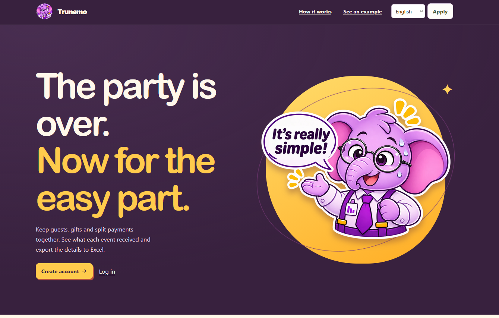
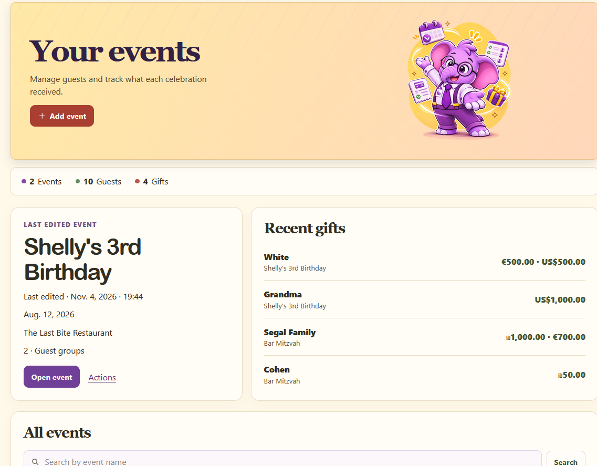
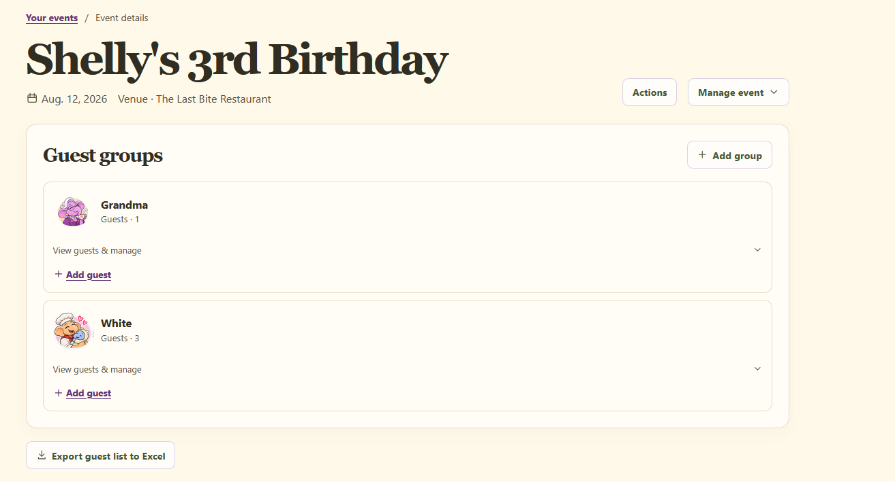
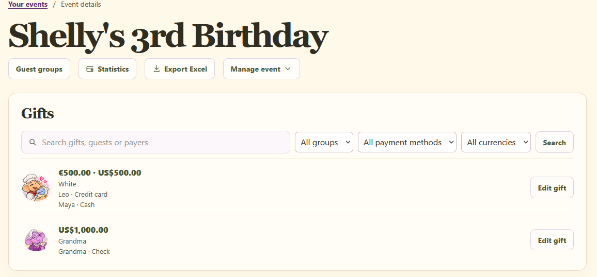
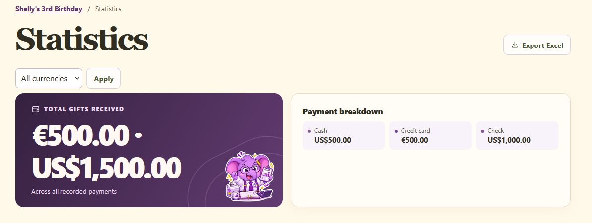
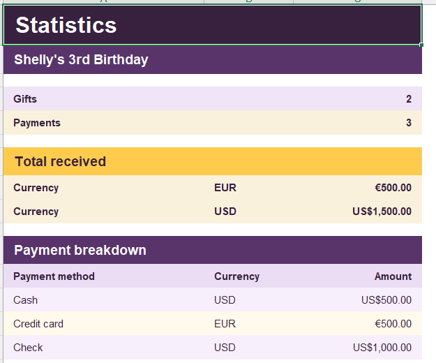
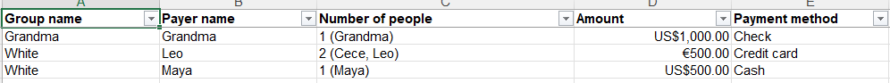

<div align="center">

# 🐘 Trunemo

### Every event, thoughtfully organized.

**A multilingual web app for managing events, guest groups, gifts, and split payments, without juggling spreadsheets.**

[**🌐 Live demo**](https://trunemo.onrender.com/) · [**💻 Source code**](https://github.com/shiranik13/trunemo) · [**🐞 Report an issue**](https://github.com/shiranik13/trunemo/issues)


<br>



</div>

## 📖 About

Trunemo started with a real request: a close friend preparing for her wedding wanted an easier, more welcoming way to keep track of guests and gifts than a collection of Excel sheets.

That idea grew into a **flexible event-management platform**. Users can create their own events, organize guests into groups, record gifts and individual payments, view totals, and export the information to Excel. There is no need to choose from a predefined list of event categories.

The project was built as a personal learning and portfolio project by **Shiran Kidron**, a B.Sc. Information Systems student.

## ✨ Features

| Area | What Trunemo offers |
| --- | --- |
| **Accounts** | User registration, login, and event ownership |
| **Event management** | Create, edit, and organize multiple events, with names, dates, venues, notes, and optional icons |
| **Guest groups** | Group guests by family, friends, or any custom label, with illustrated group avatars |
| **Guest records** | Add and manage individual guests within groups |
| **Gift tracking** | Record gifts and associate them with one or more recipients |
| **Split payments** | Track multiple payments per gift, including payer, covered guests, amount, currency, and payment method |
| **Search & filters** | Find gifts, guests, and payers; filter gift records by group, payment method, and currency |
| **Statistics** | View received amounts and payment-method breakdowns |
| **Excel export** | Export guest lists and event summaries, or payments and gift statistics, as `.xlsx` files |
| **Localization** | English, Hebrew (RTL), and Russian |

> **Currency handling:** Trunemo supports multiple currencies and reports totals **separately by currency**. It does **not** perform exchange-rate conversion.

## 📸 Screenshots

### 1. Event dashboard

A quick overview of events, guest counts, gifts, the most recently edited event, and recent gifts.



### 2. Guest groups

Organize invitees into custom groups and manage the guests within each one.



### 3. Gifts and split payments

Keep gift records, payers, payment methods, and amounts together.



### 4. Statistics

See per-currency totals and a breakdown by payment method.



### 5. Excel reports

Export readable spreadsheets with payment details and summary statistics.

<table>
  <tr>
    <td width="50%"><strong>Statistics worksheet</strong></td>
    <td width="50%"><strong>Payments worksheet</strong></td>
  </tr>
  <tr>
    <td></td>
    <td></td>
  </tr>
</table>

*Screenshots use sample event and guest data.*

## 🧰 Tech stack

| Layer | Technology |
| --- | --- |
| **Backend** | Python 3.12, Django 5.2 |
| **Database** | PostgreSQL; SQLite fallback for local development |
| **Frontend** | Django templates, HTML, CSS |
| **Excel reporting** | `openpyxl` |
| **Production** | Render, Gunicorn, WhiteNoise |
| **Localization** | Django internationalization, English / Hebrew / Russian |
| **Design & prototyping** | Figma and custom elephant-themed illustrations |

## 🧩 How it works

1. **Create an account** and sign in.
2. **Create an event** with its own name and details.
3. **Add guest groups** and the individual guests belonging to each group.
4. **Record a gift** and choose its recipients.
5. **Track payments** individually, including who paid, for whom, how much, how, and in which currency.
6. **Review statistics** and **download Excel reports** when needed.

The [live site](https://trunemo.onrender.com/) also includes a **See an example** section with illustrative sample data.

## ⚙️ Run locally

### Prerequisites

- **Python 3.12** (the version specified in `.python-version`)
- **Git**
- Optional: **PostgreSQL** if you do not want to use the default local SQLite database

### Windows (PowerShell)

```powershell
git clone https://github.com/shiranik13/trunemo.git
cd trunemo

py -3.12 -m venv .venv
.\.venv\Scripts\python.exe -m pip install -r requirements.txt
.\.venv\Scripts\python.exe manage.py migrate
.\.venv\Scripts\python.exe manage.py runserver 127.0.0.1:8011
```

### macOS / Linux

```bash
git clone https://github.com/shiranik13/trunemo.git
cd trunemo

python3.12 -m venv .venv
source .venv/bin/activate
python -m pip install -r requirements.txt
python manage.py migrate
python manage.py runserver 127.0.0.1:8011
```

Open **http://127.0.0.1:8011/**, create an account, and start with an event.

**Database default:** If `POSTGRES_DB` is not set, the standard development settings use a local SQLite database (`db.sqlite3`).

### Optional: PostgreSQL for local development

Create an empty PostgreSQL database and configure these environment variables **before** running migrations:

| Variable | Example |
| --- | --- |
| `POSTGRES_DB` | `giftmanager` |
| `POSTGRES_USER` | `your_postgres_user` |
| `POSTGRES_PASSWORD` | *(your local database password)* |
| `POSTGRES_HOST` | `127.0.0.1` |
| `POSTGRES_PORT` | `5432` |

PowerShell example:

```powershell
$env:POSTGRES_DB = "giftmanager"
$env:POSTGRES_USER = "your_postgres_user"
$env:POSTGRES_HOST = "127.0.0.1"
$env:POSTGRES_PORT = "5432"

# Prompt for the password instead of typing it into your terminal history
$credential = Get-Credential -UserName $env:POSTGRES_USER
$env:POSTGRES_PASSWORD = $credential.GetNetworkCredential().Password

.\.venv\Scripts\python.exe manage.py migrate
.\.venv\Scripts\python.exe manage.py runserver 127.0.0.1:8011
```

You can inspect the database using a tool such as **DBeaver**. The project uses Django's ORM for model-based data access.

## 🧪 Checks and tests

On Windows:

```powershell
.\.venv\Scripts\python.exe manage.py check
.\.venv\Scripts\python.exe manage.py test
```

On macOS / Linux (with the virtual environment active):

```bash
python manage.py check
python manage.py test
```

The repository includes Django tests in `events/tests.py`. If testing against PostgreSQL, the database user must have sufficient privileges to create a separate test database.

## 🗂️ Project structure

```text
trunemo/
├── events/
│   ├── models.py          # Events, groups, guests, gifts, payments
│   ├── forms.py           # Input validation and forms
│   ├── views.py           # Event and account-facing workflows
│   ├── queries.py         # Filtering and payment aggregation
│   ├── exports.py         # Excel workbook generation
│   ├── tests.py           # Django tests
│   └── static/            # Styles and visual assets
├── locale/                # Translation catalogs
├── templates/             # Shared HTML templates
├── trunemo/
│   ├── settings.py        # Local development settings
│   ├── production.py      # Deployment-specific settings
│   └── urls.py            # Top-level URL routes
├── docs/
│   └── screenshots/       # README screenshots (included in this package)
├── manage.py
├── requirements.txt
├── requirements-render.txt
└── render.yaml
```

### Main data relationships

```text
User
 └── Event
      └── GuestGroup
           ├── Guest
           └── Gift
                ├── GiftRecipient → Guest
                └── Payment → Payer (Guest)
                            → Covered guests (Guest)
```

Each event belongs to a user account. Payment totals are calculated from payment records rather than storing a separate editable gift total.

## ☁️ Deployment

The live beta is deployed on [Render](https://render.com/). The repository's `render.yaml` specifies a Python web service that:

- installs dependencies from `requirements-render.txt`;
- collects static files during the build;
- applies Django migrations at startup;
- serves Django through **Gunicorn**;
- loads production settings from `trunemo.production`.

Production requires `DATABASE_URL` and `DJANGO_SECRET_KEY` (plus the hostname supplied by Render). The production settings turn off Django debug mode, configure HTTPS-related protections, and use **WhiteNoise** for static files.

**Never commit database credentials, secret keys, or real user data to the repository.**

## 🚧 Beta notes

Trunemo is an evolving project and may contain bugs or incomplete workflows. **Password recovery is not yet available** in this version.

For evaluation and testing, use fictional guest information rather than sensitive personal data. Please report reproducible bugs using [GitHub Issues](https://github.com/shiranik13/trunemo/issues).

## 🤖 Development approach

Trunemo was developed with **AI assistance, including OpenAI Codex**, as part of a hands-on learning and portfolio project. Product requirements, interface direction, design feedback, feature prioritization, and iterative evaluation were guided by the project author.

The project is also an opportunity to deepen practical knowledge of Django, databases, software architecture, and testing through its real codebase.

## 💜 Author

**Shiran Kidron**  
B.Sc. Information Systems student, University of Haifa

- **GitHub:** [@shiranik13](https://github.com/shiranik13)
- **Live application:** [trunemo.onrender.com](https://trunemo.onrender.com/)

---

<div align="center">

**Made with care, curiosity, and a purple elephant. 🐘💜**

</div>
